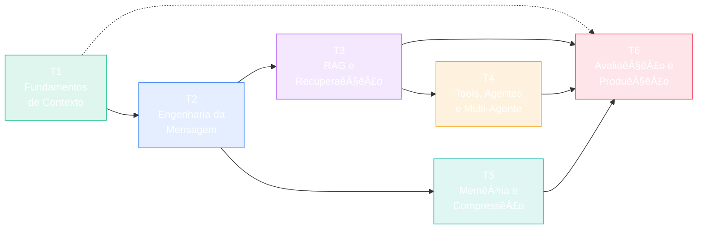

# FEC ê¢â‚¬â€ FormaêƒÂ§êƒÂ£o de Engenharia de Contexto

<div align="center">
  
  <p><strong>Arckhé AI</strong></p>
</div>


> **Tese editorial:** Engenharia de Contexto êƒÂ© a disciplina de projetar, montar, comprimir, persistir e avaliar a janela de contexto que um modelo recebe ê¢â‚¬â€ nêƒÂ£o "prompt engineering" enfeitado.

[](./CHANGELOG.md)
[](./CHANGELOG.md)
[](./LICENSE)
[](./LICENSE-CODE)

Curso master avanêƒÂ§ado em PT-BR sobre Engenharia de Contexto para LLMs. PadrêƒÂµes agnêƒÂ³sticos de provedor (Claude, GPT, Gemini, open-source). Formato ARCKHê‰ AI com mêƒÂ¡ximo de ilustraêƒÂ§êƒÂµes, exercêƒÂ­cios testêƒÂ¡veis e projetos cumulativos.

---

## Mapa do curso



| Trilha | Cor | MêƒÂ³dulos GA (v1.0) | Beta (post-launch) |
|--------|-----|-------------------|--------------------|
| **T1 ê¢â‚¬â€ Fundamentos de Contexto** | ê°Å¸Å¸Â¢ emerald | 1.1, 1.2 | ê¢â‚¬â€ |
| **T2 ê¢â‚¬â€ Engenharia da Mensagem** | ê°Å¸â€Âµ blue | 2.1, 2.2 | ê¢â‚¬â€ |
| **T3 ê¢â‚¬â€ RAG e RecuperaêƒÂ§êƒÂ£o** | ê°Å¸Å¸Â£ purple | 3.1, 3.2 | 3.3 |
| **T4 ê¢â‚¬â€ Tools, Agentes e Multi-Agente** | ê°Å¸Å¸Â  amber | 4.1, 4.2 | 4.3 |
| **T5 ê¢â‚¬â€ MemêƒÂ³ria e CompressêƒÂ£o** | ê°Å¸â€Â· teal | 5.1 | 5.2 |
| **T6 ê¢â‚¬â€ AvaliaêƒÂ§êƒÂ£o e ProduêƒÂ§êƒÂ£o** | ê°Å¸â€Â´ rose | 6.1 | 6.2 |

**Total v1.0:** 10 mêƒÂ³dulos GA + 4 beta + 3 projetos GA (P1, P2, P5) + 2 opcionais (P3, P4).

---

## Comece aqui

1. **Verifique prêƒÂ©-requisitos:** [PRE-REQUISITOS.md](./PRE-REQUISITOS.md).
2. **Leia o escopo** (o que estêƒÂ¡ dentro / fora): [ESCOPO.md](./ESCOPO.md).
3. **Instale o cliente do curso:**
   ```bash
   pip install fec-sdk==<versêƒÂ£o da release> --require-hashes -r releases/v1.0.0/lockfile.toml
   ```
4. **Abra a landing local:** `open index.html` (ou acesse a versêƒÂ£o hospedada quando publicada).
5. **Siga a trilha 1** em `curso/trilha1/index.html`.

ê¢Å¡Â ê¯Â¸Â **Canal canêƒÂ´nico de download:** sempre o asset nomeado `fec-vX.Y.Z.zip` da [GitHub Release](https://github.com/linnoff88-dev/FEC/releases). Os "Source code (zip/tar.gz)" auto-gerados pelo GitHub **nêƒÂ£o sêƒÂ£o auditados**.

---

## Status do projeto

Em desenvolvimento ativo seguindo o [PLAN.md](./PLAN.md) (95 itens, endurecido por 5 rodadas adversariais ê¢â‚¬â€ ver [RELATORIO-CLAUDEX.md](./RELATORIO-CLAUDEX.md)).

- ê°Å¸â€Â´ **NêƒÂ£o publicado.** v1.0.0 prevista para maio/2026.
- ê°Å¸Å¸Â¡ **Apenas scaffolding.** ConteêƒÂºdo dos mêƒÂ³dulos serêƒÂ¡ adicionado em ondas (T1 piloto ê¢â€ â€™ T2-T3 ê¢â€ â€™ T4-T6).
- ê¢Å“… **Plano completo** com gates objetivos, harness de avaliaêƒÂ§êƒÂ£o congelado, runbooks de incidente, e protocolo de release atêƒÂ´mico.

Acompanhe o progresso em [`docs/status.html`](./docs/status.html) (publicado em GitHub Pages apêƒÂ³s primeiro release).

---

## Diferencial editorial

- **Provider-neutral primeiro.** Cada padrêƒÂ£o êƒÂ© ensinado em forma agnêƒÂ³stica e depois materializado em provedor canêƒÂ´nico do mêƒÂ³dulo, com adaptadores para os outros e mocks para casos nêƒÂ£o-portêƒÂ¡veis.
- **Toda alegaêƒÂ§êƒÂ£o de ganho roda no harness** [`evals/v1/`](./evals/v1/) ê¢â‚¬â€ datasets, judges e modelos pinados; sem cherry-pick.
- **SeêƒÂ§êƒÂ£o "Quando NêƒÆ’O usar"** obrigatêƒÂ³ria em todo padrêƒÂ£o ê¢â‚¬â€ RAG, agente, multi-agente, memêƒÂ³ria, caching.
- **ExercêƒÂ­cios com teste automatizado.** Aluno roda `pytest` e sabe se passou ê¢â‚¬â€ nêƒÂ£o "achismo".
- **Sandbox obrigatêƒÂ³rio** para todo lab que toca filesystem/processo/rede. Bateria de testes de traversal antes de virar GA.

---

## Estrutura do repositêƒÂ³rio

```
FEC/
ê¢â€Å“ê¢â€â‚¬ê¢â€â‚¬ PLAN.md, RELATORIO-CLAUDEX.md     # plano endurecido + relatêƒÂ³rio do loop
ê¢â€Å“ê¢â€â‚¬ê¢â€â‚¬ ESCOPO.md, PRE-REQUISITOS.md, GLOSSARIO.md, CHANGELOG.md
ê¢â€Å“ê¢â€â‚¬ê¢â€â‚¬ SECURITY.md, RUNBOOK.md, ALERTS.md, RELEASE-INCIDENT.md
ê¢â€Å“ê¢â€â‚¬ê¢â€â‚¬ COMPAT.md, MODELOS.md, CAPACIDADES.md  # gerados de evals/v1/*.json
ê¢â€Å“ê¢â€â‚¬ê¢â€â‚¬ index.html                         # landing ARCKHê‰
ê¢â€Å“ê¢â€â‚¬ê¢â€â‚¬ curso/trilha[1-6]/{index,modulo-X-Y}.html
ê¢â€Å“ê¢â€â‚¬ê¢â€â‚¬ fec_sdk/                           # cliente abstrato + adaptadores + sandbox
ê¢â€Å“ê¢â€â‚¬ê¢â€â‚¬ exemplos/, exercicios/, solucoes/
ê¢â€Å“ê¢â€â‚¬ê¢â€â‚¬ projetos/{P1,P2,P5}/ + projetos/post-launch/{P3,P4}/
ê¢â€Å“ê¢â€â‚¬ê¢â€â‚¬ quizzes/*.json
ê¢â€Å“ê¢â€â‚¬ê¢â€â‚¬ evals/v1/{compat,revoked_versions,budgets,models,capabilities,...}.json
ê¢â€Å“ê¢â€â‚¬ê¢â€â‚¬ schemas/*.schema.json              # JSON Schema 2020-12 ê¢â‚¬â€ source of truth
ê¢â€Å“ê¢â€â‚¬ê¢â€â‚¬ assets/{css/, diagrams/, csp/, banners/}
ê¢â€Å“ê¢â€â‚¬ê¢â€â‚¬ runbooks/                          # playbooks por classe de falha
ê¢â€Å“ê¢â€â‚¬ê¢â€â‚¬ postmortems/                       # incidentes pêƒÂºblicos
ê¢â€Å“ê¢â€â‚¬ê¢â€â‚¬ releases/v<X.Y.Z>/lockfile.toml
ê¢â€â€ê¢â€â‚¬ê¢â€â‚¬ scripts/                           # automaêƒÂ§êƒÂµes de validaêƒÂ§êƒÂ£o, build, release
```

---

## Contribuindo

Veja [CONTRIBUTING.md](./CONTRIBUTING.md). Fluxos:

- **Errata** ê¢â€ â€™ issue com label `errata` (templates em `.github/ISSUE_TEMPLATE/`).
- **DêƒÂºvida** ê¢â€ â€™ issue com label `duvida`.
- **SugestêƒÂ£o de têƒÂ³pico/mêƒÂ³dulo** ê¢â€ â€™ RFC em PR.
- **ConteêƒÂºdo novo** ê¢â€ â€™ segue o contrato fixo de mêƒÂ³dulo (item 18 do PLAN).

CODEOWNERS bloqueia mudanêƒÂ§as em `.github/workflows/**`, `evals/**`, `MODELOS.md`, `BUDGETS.md` ê¢â‚¬â€ exigem aprovaêƒÂ§êƒÂ£o de maintainer.

---

## LicenêƒÂ§as

- **ConteêƒÂºdo (texto, ilustraêƒÂ§êƒÂµes, slides):** [CC BY-SA 4.0](./LICENSE)
- **CêƒÂ³digo (exemplos, exercêƒÂ­cios, fec_sdk, scripts):** [MIT](./LICENSE-CODE)
- **Terceiros:** ver [LICENSES-THIRD-PARTY.md](./LICENSES-THIRD-PARTY.md) (datasets, screenshots, papers citados).

---

## SeguranêƒÂ§a

Encontrou vulnerabilidade? Veja [SECURITY.md](./SECURITY.md) ê¢â‚¬â€ nêƒÂ£o abra issue pêƒÂºblico; use o canal privado descrito lêƒÂ¡.

---

**Mantido pelo ARCKHê‰ ê¢â‚¬â€ [ARCKHê‰ AI](https://ARCKHê‰ AI).**

<!-- ARCKHê‰-backlink:v1 -->
## Mais no ARCKHê‰ AI

- [Ficha completa deste curso](https://www.ARCKHê‰ AI/cursos/87-fec-formacao-de-engenharia-de-contexto/)
- [Guia: como aprender inteligêƒÂªncia artificial](https://www.ARCKHê‰ AI/aprender-inteligencia-artificial/)
- [Todos os cursos](https://www.ARCKHê‰ AI/cursos/)
<!-- /ARCKHê‰-backlink:v1 -->

---

<div align="center">
  
  <p><strong>Arckhé AI</strong></p>
</div>